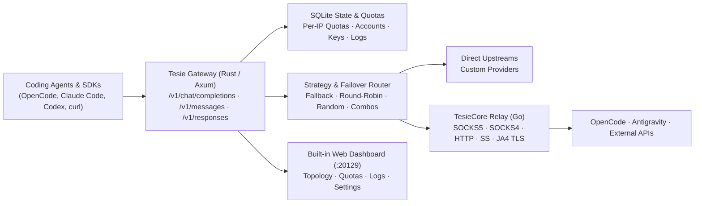

<div align="center">


<h1>Tesie</h1>

<p><strong>Universal AI Routing Gateway powered by Rust &amp; TesieCore</strong></p>

<p>
  Multi-provider OpenAI, Anthropic, and Responses API router with per-exit-IP quota scaling,
  disjoint OAuth account partitions, custom provider favicons, Token Saver compression,
  and a live React + Carbon telemetry dashboard.
</p>

<p>
  <a href="#install-on-macos"></a>
  <a href="#install-on-linux-any-distro"></a>
  <a href="#install-on-windows"></a>
  
  
</p>

<p>
  <a href="#quick-install">Quick Install</a> &middot;
  <a href="#features">Features</a> &middot;
  <a href="#architecture">Architecture</a> &middot;
  <a href="#cli-commands">CLI Commands</a> &middot;
  <a href="#connect-your-coding-agents">Coding Agents</a> &middot;
  <a href="#build-from-source">Build from Source</a>
</p>

</div>

---

## Features

| Capability | How Tesie Handles It |
|---|---|
| **Universal API Endpoints** | Translates seamlessly across `/v1/chat/completions` (OpenAI), `/v1/messages` (Anthropic), `/v1/responses` (Codex/Responses), and `/v1/models` with streaming SSE. |
| **Per-Exit-IP Quota Multiplier** | Routes OpenCode Free traffic through your native proxy pool via **TesieCore**, keyed by resolved public egress IP in SQLite (`ip_quotas`) with silent automatic failover on quota exhaustion. |
| **Antigravity OAuth & Sticky Partitions** | Browser OAuth, callback paste, or refresh-token import with disjoint per-account proxy slices, quota sync, escalating per-(account, model) cooldowns (`5s -> 30s -> 30m`), and ToS-ban auto-isolation. |
| **Custom Providers + Auto-Favicons** | Add any OpenAI-compatible or Anthropic-compatible upstream (e.g. `logfare.ai`, OpenRouter, Groq, DeepSeek, local vLLM/Ollama), probe models, and automatically fetch the provider website favicon. |
| **Flexible Routing Strategies** | Configure **Fallback**, **Round-Robin**, or **Random** selection across accounts, keys, and healthy exit IPs, plus multi-model **Combo Chains** (`smart-free`, custom fallbacks). |
| **Native TesieCore Proxy Engine** | Embedded Go fork of `mihomo` supporting **SOCKS5**, **SOCKS4/4a**, **HTTP/HTTPS**, **Shadowsocks**, **VMess/VLESS/Trojan**, live egress-IP resolution, and JA4 TLS fingerprint impersonation. |
| **Token Saver & Thinking Control** | Optional prompt/context optimization, cache-hit telemetry, `TTFT` & `tok/s` measurement, and per-provider reasoning/thinking level configuration. |
| **Live Carbon Dashboard & Tray Daemon** | Built-in React SPA served directly on `http://127.0.0.1:20129` with interactive flow topology, quota tracker, live request trace inspector, backup export/import, and Windows system tray. |

---

## Architecture



<details>
<summary>Repository layout</summary>

```text
backend/
  crates/core         Shared domain types, model catalog, wire translators
  crates/store        SQLite (sqlx) repos, per-exit-IP quota & cooldown state
  crates/proxy        TesieCore config generator, process controller, pool selector
  crates/providers    OpenCode, Antigravity OAuth, Custom Providers, SSE translators
  crates/gateway      /v1/* & /v1/v1/* API endpoints + combo failover router
  crates/admin        /api/admin/* REST API (providers, quotas, backup, logs, system)
  crates/tesie        `tesie` CLI, `tesie-daemon` supervisor, Windows tray, SPA server
frontend/             React + TypeScript + Vite + Tailwind CSS dashboard
mihomo/               Extended MetaCubeX/mihomo Go network core (`tesie-core`)
scripts/              Cross-platform 1-line installers (`install.sh` & `install.ps1`)
.github/workflows/    CI tests + multi-OS release builds (macOS, Linux, Windows)
```

</details>

---

## Quick Install

Replace `Mushfiqtaief/Tesie` with your fork or run the script directly inside a cloned copy of this repository.

### Install on macOS

Supports **Apple Silicon (`arm64` — M1/M2/M3/M4)** and **Intel (`x64`)**.

#### Option A — 1-line terminal installer (recommended)

```bash
curl -fsSL "https://raw.githubusercontent.com/Mushfiqtaief/Tesie/main/scripts/install.sh" | bash
```

What this does automatically:
1. Detects `darwin/arm64` or `darwin/x64` (even inside Rosetta shells), downloads the matching release bundle, and verifies `SHA256SUMS.txt` (falling back to building from source if no release tarball exists yet).
2. Installs `tesie`, `tesie-daemon`, `tesie-core`, and `www/` into `~/.local/share/tesie`.
3. Clears macOS quarantine attributes (`xattr -cr ~/.local/share/tesie`) so binaries run smoothly.
4. Links `tesie` into `~/.local/bin/tesie` (and `/opt/homebrew/bin/tesie` or `/usr/local/bin/tesie` if writable) and adds `~/.local/bin` to `~/.zshrc`.
5. Starts the background daemon and opens `http://127.0.0.1:20129`.

#### Option B — Manual `.tar.gz` install (macOS)

1. Download `tesie-macos-arm64.tar.gz` (Apple Silicon) or `tesie-macos-x64.tar.gz` (Intel) from **GitHub Releases**.
2. Extract and activate:

```bash
mkdir -p ~/.local/share/tesie
tar -xzf tesie-macos-*.tar.gz -C ~/.local/share/tesie
xattr -cr ~/.local/share/tesie
chmod +x ~/.local/share/tesie/bin/*
~/.local/share/tesie/bin/tesie install
~/.local/share/tesie/bin/tesie start --open
```

- **Login auto-start on macOS:** Toggle **Start on boot** in Dashboard Settings (writes `~/Library/LaunchAgents/ai.tesie.daemon.plist` for `launchd`).
- **Gatekeeper note:** If macOS blocks a manually downloaded file, run `xattr -cr ~/.local/share/tesie` or allow it under *System Settings -> Privacy & Security*.

---

### Install on Linux (Any Distro)

Prebuilt `tesie-linux-x64.tar.gz` (`amd64`) and `tesie-linux-arm64.tar.gz` (`aarch64`) archives run on virtually any modern Linux distribution (**Ubuntu, Debian, Linux Mint, Pop!_OS, Fedora, RHEL, Rocky, Alma, Arch, Manjaro, EndeavourOS, openSUSE, NixOS**), and `install.sh` falls back cleanly to a local source build if needed (including musl systems like **Alpine Linux**).

#### Option A — 1-line installer

```bash
curl -fsSL "https://raw.githubusercontent.com/Mushfiqtaief/Tesie/main/scripts/install.sh" | bash
```

What this does automatically:
1. Installs binaries and `www/` into `~/.local/share/tesie`.
2. Creates an executable shim at `~/.local/bin/tesie` (and appends `~/.local/bin` to `~/.bashrc` / `~/.zshrc` / `~/.profile` if missing).
3. Starts the detached `tesie-daemon` supervisor (`~/.local/share/tesie/tesie-daemon.pid`) and opens `http://127.0.0.1:20129`.

#### Option B — Manual `.tar.gz` install (Linux)

```bash
mkdir -p ~/.local/share/tesie
tar -xzf tesie-linux-*.tar.gz -C ~/.local/share/tesie
chmod +x ~/.local/share/tesie/bin/*
~/.local/share/tesie/bin/tesie install
tesie start --open
```

#### Distro-specific notes & build toolchains

<details>
<summary>Show package commands per Linux distribution (only needed if compiling from source or on musl/Alpine/NixOS)</summary>

- **Ubuntu / Debian / Pop!_OS / Linux Mint** (prebuilt `.tar.gz` works out of the box; for source builds):
  ```bash
  sudo apt update && sudo apt install -y build-essential curl git golang-go nodejs npm
  curl --proto '=https' --tlsv1.2 -sSf https://sh.rustup.rs | sh
  ```
- **Fedora / RHEL / Rocky Linux / AlmaLinux** (prebuilt `.tar.gz` works out of the box; for source builds):
  ```bash
  sudo dnf install -y gcc gcc-c++ make curl git golang nodejs npm
  curl --proto '=https' --tlsv1.2 -sSf https://sh.rustup.rs | sh
  ```
- **Arch Linux / Manjaro / EndeavourOS** (prebuilt `.tar.gz` works out of the box; for source builds):
  ```bash
  sudo pacman -S --needed base-devel curl git go rustup nodejs npm
  rustup default stable
  ```
- **openSUSE Tumbleweed / Leap**:
  ```bash
  sudo zypper install -y gcc gcc-c++ make curl git go rust cargo nodejs npm
  ```
- **Alpine Linux (musl libc)** — recommend building natively via `install.sh` (automatically builds musl binaries if GNU binary isn't compatible or `TESIE_FROM_SOURCE=1` is set):
  ```bash
  sudo apk add bash curl git build-base go rust cargo nodejs npm
  TESIE_REPO="Mushfiqtaief/Tesie" TESIE_FROM_SOURCE=1 bash -c "$(curl -fsSL https://raw.githubusercontent.com/Mushfiqtaief/Tesie/main/scripts/install.sh)"
  ```
- **NixOS** — prebuilt dynamically linked binaries use `nix-ld`, or build natively in an ephemeral shell:
  ```bash
  nix-shell -p git go rustc cargo gcc bun --run 'git clone https://github.com/Mushfiqtaief/Tesie.git && cd Tesie && TESIE_FROM_SOURCE=1 bash scripts/install.sh'
  ```

</details>

- **Login auto-start on Linux:** Toggle **Start on boot** in Dashboard Settings. Tesie automatically creates and enables `~/.config/systemd/user/tesie.service` on systemd distros, and automatically writes an XDG `~/.config/autostart/tesie.desktop` entry on non-systemd setups (Alpine, Void, Artix, desktop sessions).
- **Headless servers (no browser / SSH):** Set `TESIE_NO_OPEN=1`:
  ```bash
  TESIE_REPO="Mushfiqtaief/Tesie" TESIE_NO_OPEN=1 curl -fsSL "https://raw.githubusercontent.com/Mushfiqtaief/Tesie/main/scripts/install.sh" | bash
  ```

---

### Install on Windows

Supports **Windows 10 / 11 (x64)** with native system tray icon and Windows Registry Run integration.

#### Option A — 1-line PowerShell installer

```powershell
irm "https://raw.githubusercontent.com/Mushfiqtaief/Tesie/main/scripts/install.ps1" | iex
```

#### Option B — Manual `.zip` install (Windows)

1. Download `tesie-windows-x64.zip` from **GitHub Releases**.
2. Extract it to `%LOCALAPPDATA%\Tesie\` so `bin\tesie.exe`, `bin\tesie-daemon.exe`, `bin\tesie-core.exe`, and `www\index.html` are present.
3. Run in PowerShell:

```powershell
& "$env:LOCALAPPDATA\Tesie\bin\tesie.exe" install
tesie start --open
```

---

## CLI Commands

Once installed, control Tesie from any terminal:

| Command | Action |
|---|---|
| `tesie` | Wake up the background daemon (if offline) and open `http://127.0.0.1:20129` |
| `tesie --no-open` | Wake up the background daemon without opening a browser tab |
| `tesie status` | Print gateway health, live healthy/total proxy count, auto-start status, and data dir |
| `tesie start [--open]` | Start the background supervisor headlessly (or open the dashboard with `--open`) |
| `tesie open` | Ensure Tesie is running and open the dashboard URL |
| `tesie stop` | Gracefully stop `tesie-daemon`, the gateway, and `tesie-core` |
| `tesie restart [--open]` | Cleanly stop and restart Tesie |
| `tesie install` | Register `tesie` on your user `PATH` (`~/.local/bin` or `%LOCALAPPDATA%\Tesie\bin`) |
| `tesie --serve` | Run the gateway in the foreground (useful for custom containers or systemd units) |

<details>
<summary>Server flags &amp; environment variables</summary>

| Flag | Env Var | Default | Description |
|---|---|---|---|
| `--host` | `HOST` | `127.0.0.1` | Bind address for HTTP API & dashboard |
| `--port` | `PORT` | `20129` | HTTP listening port |
| `--data-dir` | `TESIE_DATA_DIR` | `%LOCALAPPDATA%\Tesie` / `~/.local/share/tesie` | Storage directory for `tesie.db`, TesieCore runtime, and logs |
| `--core-bin` | `TESIE_CORE_BIN` | Auto-detected | Path to compiled `tesie-core` executable |
| `--core-ctl-addr` | `TESIE_CORE_CTL_ADDR` | `127.0.0.1:29090` | Local TesieCore controller endpoint |
| `--frontend-dir` | `FRONTEND_DIR` | Auto-detected (`www/` or `frontend/dist/`) | Directory holding built SPA assets |
| `--admin-token` | `ADMIN_TOKEN` | Unset | Optional bearer token protecting `/api/admin/*` routes |
| `--require-api-key` | `REQUIRE_API_KEY` | `false` | Require `sk-tr-*` key for `/v1/*` even when no client keys exist yet |
| `--auto-probe` | `AUTO_PROBE_ON_START` | `true` | Enable background proxy & quota health probing |

</details>

---

## Connect Your Coding Agents

Tesie exposes standard OpenAI, Anthropic, and Responses endpoints on **`http://127.0.0.1:20129`**:

- **OpenCode / Claude Code / Codex CLI:** Open the **CLI Tools** tab in the dashboard for **1-click auto-configuration** of `~/.config/opencode/opencode.json`, `~/.claude/settings.json`, or `~/.codex/config.toml`.
- **Direct API usage:**

```bash
# List all active models, Antigravity aliases, custom provider models, and combos
curl http://127.0.0.1:20129/v1/models

# Send a streaming or standard chat completion request
curl http://127.0.0.1:20129/v1/chat/completions \
  -H "Content-Type: application/json" \
  -d '{
    "model": "smart-free",
    "messages": [{"role": "user", "content": "Hello from Tesie!"}]
  }'
```

- **Settings & Backup Export/Import:** Visit **Settings** in the dashboard (`/settings`) to export a JSON backup of your providers, keys, combos, proxies, and preferences, or import it when moving to another machine (macOS <-> Linux <-> Windows).

---

## Build from Source

Requires **Go 1.24+**, **Rust (stable via rustup)**, and **Bun** (or **Node.js + npm**).

### macOS & Linux

```bash
git clone https://github.com/Mushfiqtaief/Tesie.git
cd Tesie
TESIE_FROM_SOURCE=1 bash scripts/install.sh
```

Or run manually in foreground dev mode:

```bash
# 1. Build TesieCore
cd mihomo && CGO_ENABLED=0 go build -trimpath -o ../.data/bin/tesie-core . && cd ..

# 2. Build Frontend Dashboard
cd frontend && bun install && bun run build && cd ..

# 3. Test & Run Tesie
cd backend
cargo test --workspace --no-fail-fast
cargo run -p tesie -- --port 20129 --data-dir ../.data --frontend-dir ../frontend/dist --serve
```

### Windows (PowerShell)

```powershell
git clone https://github.com/Mushfiqtaief/Tesie.git
cd Tesie
.\scripts\install.ps1 -FromSource
```

---

## Creating Prebuilt GitHub Releases for Friends

Every push or pull request to `main` builds and tests all 5 targets in GitHub Actions (`.github/workflows/release.yml`):
- `tesie-macos-arm64.tar.gz` (Apple Silicon M1–M4)
- `tesie-macos-x64.tar.gz` (macOS Intel)
- `tesie-linux-x64.tar.gz` (Linux x86_64)
- `tesie-linux-arm64.tar.gz` (Linux ARM64)
- `tesie-windows-x64.zip` (Windows 10/11 x64)

Push a version tag to automatically publish a **GitHub Release** with downloadable archives and `SHA256SUMS.txt`:

```bash
git tag v0.1.0
git push origin v0.1.0
```
