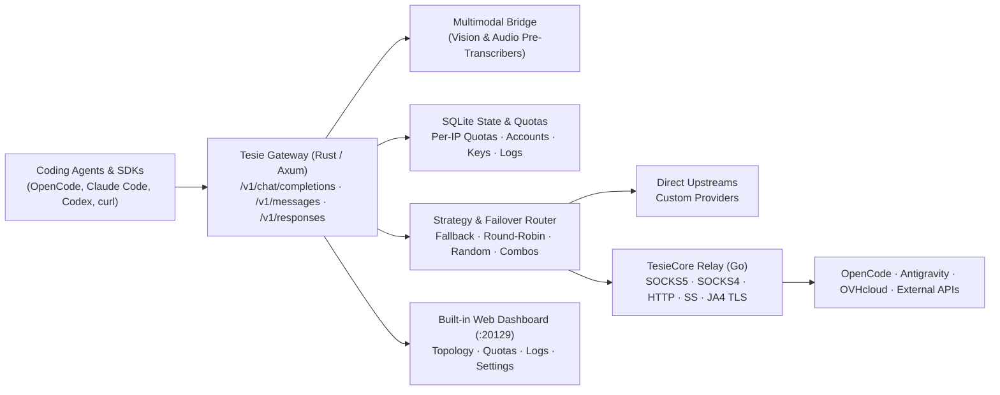

<div align="center">


# Tesie

**High-Performance AI Routing Gateway powered by Rust &amp; TesieCore**

Multi-provider OpenAI, Anthropic, and Responses API router with per-exit-IP quota scaling,
disjoint OAuth account partitions, custom provider adapters, Multimodal Vision &amp; Audio Bridge,
Token Saver compression, and a live React + Carbon telemetry dashboard.

[](#install-on-macos)
[](#install-on-linux-any-distro)
[](#install-on-windows)
[](#architecture)
[](LICENSE)

[Quick Install](#quick-install) &middot;
[Features](#features) &middot;
[Architecture](#architecture) &middot;
[CLI Commands](#cli-commands) &middot;
[Coding Agents](#connect-your-coding-agents) &middot;
[Contributors](#contributors)

</div>

---

## Features

| Capability | How Tesie Handles It |
|---|---|
| **Universal API Endpoints** | Translates seamlessly across `/v1/chat/completions` (OpenAI), `/v1/messages` (Anthropic), `/v1/responses` (Codex/Responses), and `/v1/models` with streaming SSE. |
| **Multimodal Bridge** | Automatically attaches visual descriptions (Vision) and audio transcripts (Audio) to requests directed at text-only models with zero prompt alteration. |
| **Per-Exit-IP Quota Multiplier** | Routes OpenCode Free traffic through your native proxy pool via **TesieCore**, keyed by resolved public egress IP in SQLite (`ip_quotas`) with silent automatic failover on quota exhaustion. |
| **Antigravity OAuth &amp; Sticky Partitions** | Browser OAuth, callback paste, or refresh-token import with disjoint per-account proxy slices, quota sync, escalating per-(account, model) cooldowns (`5s -> 30s -> 30m`), and ToS-ban auto-isolation. |
| **OVHcloud &amp; Custom Providers** | Native support for OVHcloud AI Endpoints with per-IP rate-limiting tracking and auto-favicons for any custom OpenAI/Anthropic upstream. |
| **Intelligent Model Combos** | Configure **Fallback**, **Round-Robin**, or **Random** selection across accounts, keys, and healthy exit IPs with calculated conservative safe context/output token limits. |
| **Native TesieCore Proxy Engine** | Embedded Go fork of `mihomo` supporting **SOCKS5**, **SOCKS4/4a**, **HTTP/HTTPS**, **Shadowsocks**, **VMess/VLESS/Trojan**, live egress-IP resolution, and JA4 TLS fingerprint impersonation. |
| **Token Saver &amp; Thinking Control** | Optional prompt/context optimization, cache-hit telemetry, `TTFT` &amp; `tok/s` measurement, and per-provider reasoning/thinking level configuration. |
| **Portable Proxy Export** | Export healthy and ready proxies directly as standard connection URLs for external tools and CLI workflows. |

---

## Architecture



<details>
<summary>Repository layout</summary>

```text
backend/
  crates/core         Shared domain types, model catalog, wire translators, bridge types
  crates/store        SQLite (sqlx) repos, per-exit-IP quota & cooldown state
  crates/proxy        TesieCore config generator, process controller, pool selector
  crates/providers    OpenCode, Antigravity OAuth, OVHcloud, Custom Providers, SSE translators
  crates/gateway      /v1/* & /v1/v1/* API endpoints + combo failover router + multimodal bridge
  crates/admin        /api/admin/* REST API (providers, quotas, backup, logs, bridge stats)
  crates/tesie        `tesie` CLI, `tesie-daemon` supervisor, Windows tray, SPA server
frontend/             React 19 + TypeScript + Vite + Tailwind CSS dashboard
mihomo/               Extended MetaCubeX/mihomo Go network core (`tesie-core`)
scripts/              Cross-platform 1-line installers (`install.sh` & `install.ps1`)
.github/workflows/    CI tests + multi-OS release builds (macOS, Linux, Windows)
```

</details>

---

## Quick Install

### Install on macOS

Supports **Apple Silicon (`arm64` — M1/M2/M3/M4)** and **Intel (`x64`)**.

#### Option A — 1-line terminal installer (recommended)

```bash
curl -fsSL "https://raw.githubusercontent.com/Mushfiqtaief/Tesie/main/scripts/install.sh" | bash
```

#### Option B — Manual `.tar.gz` install (macOS)

1. Download `tesie-macos-arm64.tar.gz` (Apple Silicon) or `tesie-macos-x64.tar.gz` (Intel) from **GitHub Releases**.
2. Extract and activate:

```bash
mkdir -p ~/.local/share/tesie
tar -xzf tesie-macos-*.tar.gz -C ~/.local/share/tesie
xattr -cr ~/.local/share/tesie
chmod +x ~/.local/share/tesie/bin/*
~/.local/share/tesie/bin/tesie install
~/.local/share/tesie/bin/tesie start --open
```

---

### Install on Linux (Any Distro)

Prebuilt archives run on **Ubuntu, Debian, Fedora, Arch, openSUSE, Alpine, NixOS**, and any systemd/non-systemd desktop or headless server.

#### Option A — 1-line installer

```bash
curl -fsSL "https://raw.githubusercontent.com/Mushfiqtaief/Tesie/main/scripts/install.sh" | bash
```

#### Option B — Manual `.tar.gz` install (Linux)

```bash
mkdir -p ~/.local/share/tesie
tar -xzf tesie-linux-*.tar.gz -C ~/.local/share/tesie
chmod +x ~/.local/share/tesie/bin/*
~/.local/share/tesie/bin/tesie install
tesie start --open
```

---

### Install on Windows

Supports **Windows 10 / 11 (x64)** with native system tray icon and auto-start support.

#### Option A — 1-line PowerShell installer

```powershell
irm "https://raw.githubusercontent.com/Mushfiqtaief/Tesie/main/scripts/install.ps1" | iex
```

#### Option B — Manual `.zip` install (Windows)

1. Download `tesie-windows-x64.zip` from **GitHub Releases**.
2. Extract it to `%LOCALAPPDATA%\Tesie\`.
3. Run in PowerShell:

```powershell
& "$env:LOCALAPPDATA\Tesie\bin\tesie.exe" install
tesie start --open
```

---

## CLI Commands

| Command | Action |
|---|---|
| `tesie` | Wake up the background daemon (if offline) and open `http://127.0.0.1:20129` |
| `tesie --no-open` | Wake up the background daemon without opening a browser tab |
| `tesie status` | Print gateway health, live healthy/total proxy count, auto-start status, and data dir |
| `tesie start [--open]` | Start the background supervisor headlessly (or open the dashboard with `--open`) |
| `tesie open` | Ensure Tesie is running and open the dashboard URL |
| `tesie stop` | Gracefully stop `tesie-daemon`, the gateway, and `tesie-core` |
| `tesie restart [--open]` | Cleanly stop and restart Tesie |
| `tesie install` | Register `tesie` on your user `PATH` |
| `tesie --serve` | Run the gateway in the foreground |

---

## Connect Your Coding Agents

Tesie exposes standard OpenAI, Anthropic, and Responses endpoints on **`http://127.0.0.1:20129`**:

- **OpenCode / Claude Code / Codex CLI:** Open the **CLI Tools** tab in the dashboard for **1-click auto-configuration** of `~/.config/opencode/opencode.json`, `~/.claude/settings.json`, or `~/.codex/config.toml`.
- **Direct API usage:**

```bash
# List all active models, Antigravity aliases, custom provider models, and combos
curl http://127.0.0.1:20129/v1/models

# Send a chat completion request to an intelligent combo chain
curl http://127.0.0.1:20129/v1/chat/completions \
  -H "Content-Type: application/json" \
  -d '{
    "model": "smart-free",
    "messages": [{"role": "user", "content": "Hello from Tesie!"}]
  }'
```

---

## Contributors

Tesie is proudly crafted and maintained by:

- **[Mushfiq Taief](https://github.com/Mushfiqtaief)** — Creator &amp; Lead Architect
- **[Tahsin Arafat](https://github.com/TahsinArafat)** — Core Contributor (Proxy URL export, feature engineering &amp; testing)

---

## License

Released under the [MIT License](LICENSE).
