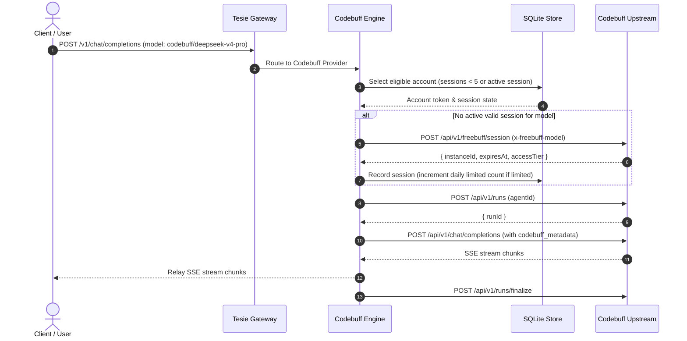

# Codebuff Provider Integration Design

## Intent & Why
Add **Codebuff** (`https://www.codebuff.com`) as a first-class native provider within the Tesie AI Routing Gateway (alongside Antigravity, OpenCode, and OVH). Codebuff provides free and limited-tier access to high-performance LLMs (such as DeepSeek V4 Pro, DeepSeek V4 Flash, MiniMax M3, and Kimi K2.6) for GitHub-authenticated users. 

This integration gives Tesie users:
1. **Multi-account GitHub authentication** with frictionless OAuth or token import.
2. **5-Session Daily Quota Tracking** in `/quotas` with live 1-hour session expiration countdowns and daily session budget indicators.
3. **Multi-account round-robin load-balancing and automatic fallback** when an account's 5 daily limited sessions are exhausted.

---

## Goals, Non-Goals, & Anti-Goals

### Goals
- **First-Class Provider**: Add `ProviderKind::Codebuff` in `backend/crates/core`, with full routing support via `codebuff/<model>` or canonical aliases.
- **Multi-Account OAuth Management**: Seamless GitHub OAuth start & status polling (or direct token entry), persisting accounts in the SQLite `connections` table.
- **Session Lifecycle & Daily Quota Engine**:
  - Automatically acquire, bind, and cache upstream 1-hour session instances (`POST /api/v1/freebuff/session`).
  - Track active 1-hour session timers and remaining daily session budgets (5 per day on Limited tier; unlimited on Free tier).
  - Expose clean session quota snapshots to the frontend `/api/quotas` endpoint.
- **Smart Load-Balancing & Fallback**:
  - Distribute requests across all active Codebuff accounts.
  - When Account A hits its 5-session daily limit or cooling lock, automatically fall back to Account B, Account C, etc.
- **Full Streaming Support**: Support SSE streaming for chat completions with upstream Codebuff run chains (`/api/v1/runs` $\to$ `/api/v1/chat/completions` $\to$ `/api/v1/runs/finalize`).
- **UI Dashboard**:
  - `ProvidersView.tsx`: Codebuff provider card with "+ Add Account" (OAuth pop-up & token paste modal), account avatars/emails, and status badges.
  - `QuotaTrackerView.tsx`: Codebuff Quota card displaying each connected account with a 5-session daily progress bar (`X / 5 left`) and active 1-hour session countdown timer.

### Non-Goals
- Running external Node.js or Bun processes as sidecars (everything must be self-contained in the native Rust binary).
- Providing billing or paid Codebuff tier management beyond the free and limited session mechanics.
- Bypassing Cloudflare bot protection if upstream actively blocks raw IP addresses (we leverage Tesie's existing proxy controller when proxy routing is enabled).

### Anti-Goals
- Disrupting existing Antigravity, OpenCode, or OVH provider configurations.
- Overwriting external tool configs without explicit user consent.
- Modifying proxy pool states on non-network errors.

---

## Constraints
- **Self-Contained Executable**: Native Rust implementation inside `tesie-providers` and `tesie-gateway`. No node runtime dependencies.
- **Storage Layer**: Must use the existing SQLite database (`tesie.db`) using the `connections`, `provider_configs`, and quota tables.
- **API Compatibility**: OpenAI-compatible format for `/v1/chat/completions` and `/v1/models`.
- **Session Window**: 1 hour per session instance, with a 5-second safety buffer before token expiration.

---

## Approaches Evaluated

### Approach 1: Native Rust Provider Engine (Selected)
- **Architecture**: Implement `tesie_providers::codebuff` entirely in Rust:
  - `oauth.rs`: GitHub OAuth start/poll client and token persistence.
  - `session.rs`: 1-hour session lifecycle management, model binding, daily 5-session quota counter.
  - `catalog.rs`: Model definitions, tier classification (Free vs Limited), multimodal metadata.
  - `executor.rs`: Upstream run-chain orchestration, request payload encoding, SSE streaming relay.
- **Why Selected**: Zero external runtime dependencies, lightweight, unified binary architecture, blazing fast latency, and direct integration with Tesie's SQLite store and frontend.

### Approach 2: Embedded Node.js Subprocess Bridge (Rejected)
- **Architecture**: Spawn `notBlubbll/free-buff-lol` as a child process via Node.js on port 8080 and forward requests through Tesie's Custom Provider.
- **Why Rejected**: Requires Node.js/Bun installed on user machines, consumes additional memory/ports, prone to subprocess zombie leaks, and lacks tight integration with Tesie's multi-account database and quota system.

---

## System Architecture & Detailed Design

### 1. Data Model & Storage

In `backend/crates/core/src/models.rs`:
```rust
pub enum ProviderKind {
    OpenCodeFree,
    Antigravity,
    Ovh,
    Codebuff,
}
```

In `backend/crates/core/src/`:
Add `CodebuffQuotaSnapshot` and `CodebuffAccountQuota`:
```rust
#[derive(Debug, Clone, Serialize, Deserialize)]
pub struct CodebuffAccountQuota {
    pub account_id: String,
    pub email: String,
    pub name: Option<String>,
    pub limited_sessions_used_today: u32,
    pub limited_sessions_total: u32,       // 5
    pub active_session: Option<CodebuffActiveSessionInfo>,
    pub status: String,                    // "active", "cooldown", "expired"
}

#[derive(Debug, Clone, Serialize, Deserialize)]
pub struct CodebuffActiveSessionInfo {
    pub instance_id: String,
    pub model: String,
    pub expires_at: i64,                  // unix ms
    pub remaining_seconds: i64,
    pub access_tier: String,               // "free" | "limited"
}
```

### 2. Upstream Protocol Flow



### 3. Frontend Architecture

1. **`ProvidersView.tsx`**:
   - Add Codebuff card with logo/badge.
   - Show connected GitHub accounts with avatar, email, and removal button.
   - "+ Add GitHub Account" button opening an interactive modal:
     - Option A: One-click "Log in with GitHub" (initiates OAuth, opens `https://freebuff.com/login?auth_code=...`, polls status, and stores account).
     - Option B: Manual token input ("Paste Auth Token").
2. **`QuotaTrackerView.tsx`**:
   - Add **Codebuff Quotas** section.
   - Per-account gauges:
     - `Limited Sessions Today: X / 5` with visual progress bar.
     - `Active Session Status`: Live countdown badge (e.g. `🟢 Active on DeepSeek V4 Pro (44m remaining)` or `⚪ Idle`).
     - Reset button / force end session button.

---

## Implementation Stages

1. **Core Data Structures & Store**:
   - Register `ProviderKind::Codebuff`.
   - Add database queries for Codebuff accounts and session quotas.
2. **Codebuff Provider Crate (`tesie-providers/src/codebuff/`)**:
   - `catalog.rs`: Model definitions (DeepSeek, MiniMax, Kimi, Gemini, etc.).
   - `oauth.rs`: GitHub OAuth handshake and token validation.
   - `session.rs`: 1-hour session cache, daily session rollover at midnight UTC.
   - `executor.rs`: Run-chain startup, payload preparation, SSE streaming relay, run-chain finalization.
3. **Gateway & Admin Endpoints**:
   - Register Codebuff in `aggregator.rs` and request dispatcher.
   - Add admin endpoints: `/api/providers/codebuff/accounts`, `/api/providers/codebuff/oauth/start`, `/api/providers/codebuff/oauth/poll`, `/api/quotas/codebuff`.
4. **Frontend UI**:
   - `ProvidersView.tsx`: Codebuff account management & OAuth modal.
   - `QuotaTrackerView.tsx`: Multi-account 5-session daily tracker with active countdown timers.
   - `api.ts`: API clients for Codebuff accounts and quota fetching.
5. **Testing & Verification**:
   - Unit tests for session rollover, 5-session daily cap, model binding locks, and SSE stream formatting.
   - End-to-end live testing with real token / OAuth session.
